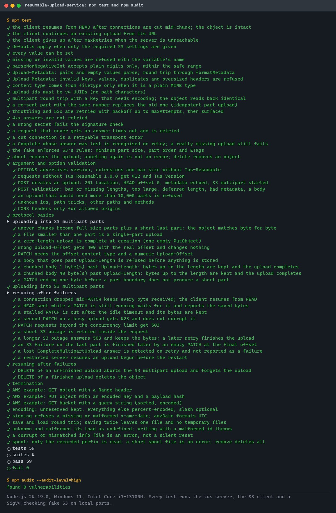
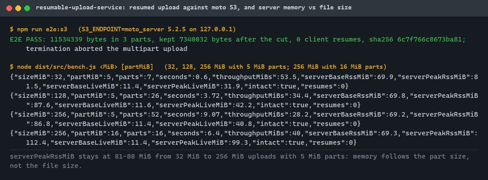
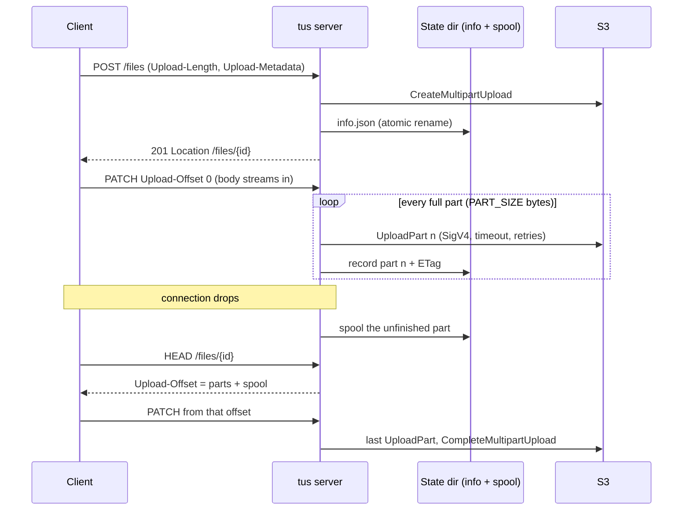
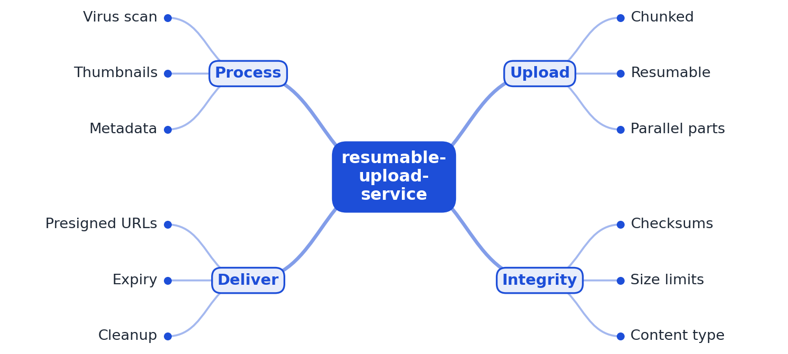

# resumable-upload-service

[](https://github.com/EquinoxWN/resumable-upload-service/actions/workflows/ci.yml)


> A 2 GB upload fails at 99% on a train and starts again. This service implements the tus 1.0.0 resumable-upload protocol and streams each chunk into an S3 multipart upload, so a dropped connection costs only the bytes in flight and the server holds at most one part in memory.

Part of my **Backend and API** list · TypeScript · core project

## Proof it works

59 tests run the tus server, the S3 client and a fake S3 that checks SigV4 signatures and S3's multipart rules, all on local ports: chunked uploads, dropped and stalled connections, S3 outages, lost answers, restarts and termination. 59 passed, 0 failed; `npm audit` finds 0 vulnerabilities:



The same upload path against moto 5.2.5 (an independent S3 implementation) with real 5 MiB parts: a connection cut at 7 MiB of 11 MiB, the resumed upload reads back with the same SHA-256, and termination aborts the multipart upload. The memory benchmark shows the server's peak RSS at 81-88 MiB whether the file is 32 MiB or 256 MiB:



## Architecture

**What M1 runs today:**



**Full roadmap (M1 to M3):**



## How it works

_Steps 1 and 2 are built and tested (M1); the rest is on the [roadmap](#roadmap)._

1. Clients upload in chunks using the tus protocol; after a dropped connection they ask for the offset and continue.
2. Chunks stream straight into S3 multipart uploads, so the server never holds a whole file in memory.
3. Checksums verify each chunk and the final file; size and content-type limits are enforced.
4. Completed uploads go to a worker that scans them with ClamAV and generates thumbnails.
5. Downloads use short-lived presigned URLs, and abandoned uploads are cleaned up automatically.
6. Tests cut connections mid-upload on a simulated slow network and verify resumption and integrity.

What M1 does in detail:

- **tus 1.0.0 core, creation and termination.** `POST` creates an upload, `HEAD` returns `Upload-Offset`, `PATCH` appends at that offset (409 on a mismatch), `DELETE` aborts it, `OPTIONS` lists capabilities. Any tus client (tus-js-client, the included Node.js client) can talk to it.
- **Streaming into S3 parts.** A `PATCH` body is copied into one part-sized buffer; each time it fills, it is sent as the next `UploadPart` and recorded before more of the body is read, so backpressure reaches the client. Every part but the last has exactly `PART_SIZE` bytes, as S3 requires (5 MiB minimum).
- **Nothing received is lost.** If the client drops, stalls past `IDLE_TIMEOUT_MS` or S3 refuses a part, the unfinished part is written to a spool file and counted in `Upload-Offset`. A `HEAD` that arrives while a `PATCH` is still saving waits for it (up to 3 s).
- **Safe retries.** S3 calls have a deadline, and throttling, 5xx and transport errors are retried with backoff (3 attempts). Re-sending a part overwrites the same part number; a `CompleteMultipartUpload` whose answer was lost is recognised on retry. State files are written to a temporary file and renamed.
- **Own S3 client.** SigV4 signing on `node:crypto`, checked against the AWS documentation's example signatures; no runtime dependencies.

## Who it helps

- **Who:** Teams whose users upload large files (video, datasets, backups) over unreliable mobile or train connections.
- **The problem:** A plain HTTP upload that drops at 99% starts again from zero, and a server that buffers whole files runs out of memory under a few large uploads.
- **How to use it:** Run the server in front of an S3-compatible bucket and point a tus client (tus-js-client in the browser, or the included Node.js client) at `/files`. Uploads resume from the server's offset after any drop, and memory per upload is bounded by the part size.

## Tech stack

| Area | In M1 | Planned |
|---|---|---|
| Core | TypeScript on Node.js 24 `node:http`, tus 1.0.0 (core, creation, termination) | tus checksum and expiration extensions |
| Storage | S3 multipart uploads via an own SigV4 client; upload state and spool files on local disk | MinIO in CI, shared state for several server nodes |
| Processing | - | checksum verification, ClamAV scan hook, thumbnails in a worker |
| Test | `node:test` against a SigV4-checking fake S3; moto 5.2.5 end-to-end run | simulated slow network with connection cuts at scale |

Language: **TypeScript** (strict, compiled with `tsc`). Server in [`src/server.ts`](src/server.ts), S3 client in [`src/s3.ts`](src/s3.ts), SigV4 in [`src/sigv4.ts`](src/sigv4.ts), Node.js client in [`src/client.ts`](src/client.ts), the fake S3 in [`src/testing/fakes3.ts`](src/testing/fakes3.ts).

## Run it

**Prerequisites:** Node.js 24+. Only dev dependencies (TypeScript, `@types/node`) install into `node_modules/`; the server has no runtime dependencies.

```bash
make setup   # npm ci
make lint    # strict TypeScript type check
make test    # 59 tests against local servers (fake S3 data under .tmp/, removed after each test)
make bench   # server memory while uploading 32, 128 and 256 MiB
make audit   # npm audit
```

Run the server against an S3-compatible store:

```bash
S3_ENDPOINT=http://127.0.0.1:9000 S3_BUCKET=uploads \
S3_ACCESS_KEY_ID=... S3_SECRET_ACCESS_KEY=... npm start
```

| Variable | Required | Default | Meaning |
|---|---|---|---|
| `S3_ENDPOINT` | yes | - | S3 endpoint URL (http or https) |
| `S3_BUCKET` | yes | - | Bucket for uploaded objects (keys `uploads/<id>`) |
| `S3_ACCESS_KEY_ID` | yes | - | Access key |
| `S3_SECRET_ACCESS_KEY` | yes | - | Secret key |
| `S3_REGION` | no | `us-east-1` | Region used in the signature |
| `S3_FORCE_PATH_STYLE` | no | `true` | `endpoint/bucket/key` URLs; `false` for `bucket.endpoint/key` |
| `S3_TIMEOUT_MS` | no | `60000` | Deadline per S3 request attempt (1,000 to 600,000) |
| `PART_SIZE` | no | `8388608` (8 MiB) | Bytes per S3 part, 5 MiB to 64 MiB; also the memory held per running `PATCH` |
| `MAX_UPLOAD_SIZE` | no | 5 GiB | Largest `Upload-Length`, at most `PART_SIZE` x 10,000 |
| `STATE_DIR` | no | `data/uploads` | Directory for upload info and spool files |
| `IDLE_TIMEOUT_MS` | no | `30000` | A `PATCH` that sends nothing this long is cut (its bytes are kept) |
| `MAX_CONCURRENT_PATCHES` | no | `16` | Running `PATCH` requests; more get 503 with `Retry-After` |
| `PORT` | no | `8080` | Listening port (0 to 65535) |
| `HOST` | no | `127.0.0.1` | Listening address |
| `ALLOWED_ORIGINS` | no | none | Comma-separated browser origins that get CORS headers |

Invalid values exit with code 2 and the variable's name.

### Protocol

| Request | Answer |
|---|---|
| `OPTIONS /files` | 204, `Tus-Version: 1.0.0`, `Tus-Extension: creation,termination`, `Tus-Max-Size` |
| `POST /files` with `Upload-Length`, optional `Upload-Metadata` | 201 `Location: /files/<id>`; 400 bad header, 413 too large |
| `HEAD /files/<id>` | 200 `Upload-Offset`, `Upload-Length`, `Upload-Metadata`; 404 unknown |
| `PATCH /files/<id>`, `Content-Type: application/offset+octet-stream`, `Upload-Offset` | 204 new `Upload-Offset`; 409 offset mismatch, 413 past the length, 415 content type, 423 another `PATCH` is running, 503 S3 unavailable or too many uploads |
| `DELETE /files/<id>` | 204; aborts the multipart upload (or deletes the finished object) |

Every request except `OPTIONS` needs `Tus-Resumable: 1.0.0` (412 otherwise). `Upload-Metadata` `filetype` becomes the object's content type when it is a plain MIME type.

### Use the Node.js client

```ts
import { upload, bufferSource } from "resumable-upload-service";
const { url, resumes } = await upload({
  endpoint: "http://127.0.0.1:8080/files",
  source: bufferSource(bytes),        // or any { size, read(start, end) }
  metadata: { filename: "video.mp4", filetype: "video/mp4" },
  chunkSize: 4 * 1024 * 1024,
});
```

After a failed `PATCH` the client waits (exponential backoff), asks `HEAD` for the offset and continues; it gives up after `maxRetries` failures in a row.

## Tests and results

Full numbers and commands: [docs/results/m1.md](docs/results/m1.md). The 10-rule quality check (failure paths, retry safety, mutation testing) is in [docs/quality/2026-11-01.md](docs/quality/2026-11-01.md).

| Test file | Tests | What it proves |
|---|---|---|
| `server.test.ts`, protocol basics | 7 | `OPTIONS` capabilities; 412 without `Tus-Resumable`; creation with metadata; nine malformed or oversized creation requests refused before S3 is touched; the 10,000-part limit; unknown ids, path tricks, wrong paths and methods; CORS only for allowed origins |
| `server.test.ts`, uploading into S3 parts | 9 | Uneven chunks become full 64 KiB parts plus a short last part and the object matches byte for byte; single-part and zero-length uploads; 409 with the real offset; 415 and 400 on bad headers; a body past the length refused up front; chunked bodies 1 and 40 bytes past the length cut exactly; a `PATCH` ending one byte before a part boundary leaves no short part |
| `server.test.ts`, resuming after failures | 10 | A dropped connection keeps every received byte (parts plus spool); `HEAD` waits for a `PATCH` that is still saving; a stalled `PATCH` is cut by the idle timeout with its bytes kept; 423 for a second `PATCH`; 503 past the concurrency limit; a short S3 outage retried inside the request; a long one answered 503 with the bytes spooled; a failed last part finished by a later `PATCH`; a lost `CompleteMultipartUpload` answer; a restarted server resumes an upload |
| `server.test.ts`, termination | 2 | `DELETE` aborts the S3 multipart upload and removes the state; on a finished upload it deletes the object |
| `s3.test.ts` | 11 | Multipart round trip with a key that needs encoding; re-sent parts replace old ones; 5xx and throttling retried up to the limit, 4xx not; a wrong secret fails the signature check; a request with no answer times out and is retried; a cut connection is retried; a lost Complete answer is recognised; the fake enforces minimum part size, part order and ETags; abort and delete; option validation |
| `sigv4.test.ts` | 5 | The three example signatures from the AWS S3 documentation (GET with Range, PUT with an encoded key, GET with a query string); percent-encoding; missing `x-amz-date` refused |
| `client.test.ts` | 3 | The client resumes after a proxy cuts two connections mid-chunk and the object is intact; it continues an upload from its URL; it gives up after `maxRetries` |
| `protocol.test.ts` | 5 | Integer headers, `Upload-Metadata` parsing and limits, content type from metadata, upload id format |
| `store.test.ts` | 4 | Atomic save and load, refused ids, corrupt files reported (not reset), spool prefix reads |
| `config.test.ts` | 3 | Defaults, every variable, fourteen invalid values refused by name |

| Check | Result |
|---|---|
| Tests (`make test`) | **59 passed**, 0 failed (about 5 s) |
| End to end against moto 5.2.5 (`npm run e2e:s3`) | 11 MiB + 3 bytes in 3 parts of 5 MiB; 7 MiB kept after the cut; SHA-256 matches; termination aborts the multipart upload |
| Mutation check | 12 of 12 hand mutations killed (10 before two tests were added) |
| Lint | strict `tsc`: no errors |
| Audit | `npm audit`: 0 vulnerabilities |

| `make bench` (server in its own process, 5 MiB parts) | Parts | Server peak RSS | Server peak live heap + buffers |
|---|---|---|---|
| 32 MiB | 7 | 81.5 MiB | 31.9 MiB |
| 128 MiB | 26 | 87.6 MiB | 42.2 MiB |
| 256 MiB | 52 | 86.8 MiB | 40.8 MiB |
| 256 MiB, 16 MiB parts | 16 | 112.4 MiB | 99.3 MiB |

Memory stays flat as the file grows eightfold and rises with the part size. Multi-GB uploads and a simulated slow network are M3.

## Roadmap

**M1** (≈15 h)
- [x] Write `docs/rfc/0001-design.md`: problem, goals, non-goals, chosen design
- [x] Clients upload in chunks using the tus protocol; after a dropped connection they ask for the offset and continue.
- [x] Chunks stream straight into S3 multipart uploads, so the server never holds a whole file in memory.

**M2** (≈20 h)
- [ ] Checksums verify each chunk and the final file; size and content-type limits are enforced.
- [ ] Completed uploads go to a worker that scans them with ClamAV and generates thumbnails.

**M3** (≈25 h)
- [ ] Downloads use short-lived presigned URLs, and abandoned uploads are cleaned up automatically.
- [ ] Tests cut connections mid-upload on a simulated slow network and verify resumption and integrity.
- [ ] Publish the proof below with real numbers

## Proof

What this repo must show before it counts as done:

- Resume success under simulated network drops, with server memory flat during multi-GB uploads.

| Result | Value |
|---|---|
| M3 proof above | Not measured yet (M3). Current M1 numbers: see [Tests and results](#tests-and-results) (flat memory from 32 to 256 MiB). |

## Why it matters

- **Interview angle:** 'Design file upload for Google Drive or WhatsApp' and large-payload questions.
- **Upstream I'd like to contribute to:** tus (tusd or tus-js-client): docs or tests.

## Design docs

- [RFC 0001: design](docs/rfc/0001-design.md)
- [ADR 0001: record architecture decisions](docs/adr/0001-record-architecture-decisions.md)
- [ADR 0002: own SigV4 S3 client on node:http](docs/adr/0002-own-s3-client-on-node-http.md)
- [ADR 0003: spool the unfinished part on local disk](docs/adr/0003-spool-unfinished-part-on-local-disk.md)
- [M1 results](docs/results/m1.md)

## Scope

This is a learning and portfolio system, not a hosted production service. Everything runs locally. M1 keeps upload state on one server's disk, so one upload must stay on one server node (see ADR 0003).

## Security and contributing

- Every GitHub Action is pinned to a commit SHA; workflows run read-only, without persisted credentials.
- Dependabot update pull requests are paused (`open-pull-requests-limit: 0`) so the repository keeps a single `main` branch; dependencies are updated by hand and checked by the CI audit.
- Upload ids are server-generated UUIDs checked before any file path is built; headers and metadata are size-limited; memory per upload is bounded by the part size and the number of running uploads by `MAX_CONCURRENT_PATCHES`.
- Report vulnerabilities privately: see [SECURITY.md](SECURITY.md). To contribute, see [CONTRIBUTING.md](CONTRIBUTING.md).

## License

MIT, see [LICENSE](LICENSE).
